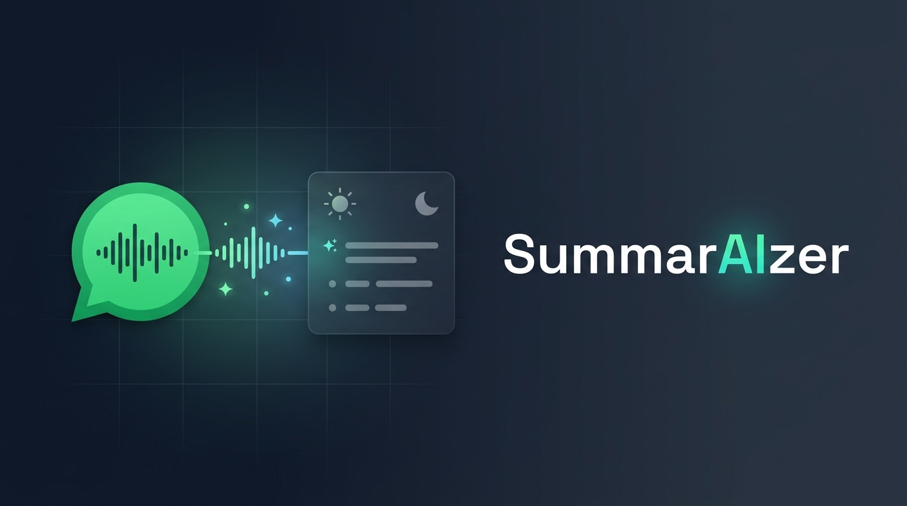

<p align="center">
  
</p>

# SummarAIzer

Un piccolo companion per WhatsApp scritto in Node.js che gira in background, legge messaggi e note vocali da chat e gruppi, e ti manda direttamente nella tua chat personale (*"Messaggi a te stesso"*) due recap al giorno:

- **Mattina (08:15)**: riassunto completo delle ultime 24 ore.
- **Sera (22:00)**: aggiornamento veloce solo con quello che si è aggiunto durante la giornata dopo il recap del mattino.

Tutto viene diviso automaticamente tra **Lavoro** e **Vita Privata**, tenendo conto anche delle tue risposte per dirti cosa hai già gestito (`✅ Già risolto`), cosa è rimasto in sospeso (`⏳ In attesa`) e cosa richiede ancora una tua risposta (`🔴 Da fare`).

---

## Perché è fatto così (e come evita i limiti di quota)

Il problema principale quando si passano intere giornate di chat e vocali a un modello LLM è che i file audio pesano parecchio e mandare tutto in base64 dentro il JSON fa esplodere subito i limiti di token al minuto (TPM).

Per non far fallire mai il job mattutino, SummarAIzer usa tre accorgimenti:

1. **Upload dei vocali tramite Gemini File API (`files.upload`)**
   I vocali ricevuti (`.ogg` / Opus) vengono salvati localmente e caricati tramite la File API prima di generare il riassunto. Nel prompt passano solo gli URI dei file caricati, che vengono poi eliminati dai server di Google appena finito il recap.
2. **Gestione "Mappazzone XL" (Chunking automatico)**
   - Se il totale dei vocali della giornata resta sotto i **60 minuti**, parte una chiamata unica.
   - Se supera la soglia, lo script divide automaticamente messaggi e audio in **2 blocchi cronologici** (es. mattina/pomeriggio e sera/notte) distanziati da **65 secondi** di pausa per azzerare la finestra dei TPM, e poi fa una terza chiamata leggera di merge per unire i due mini-riassunti.
   - Nel merge tiene traccia anche delle questioni aperte nel primo blocco ma risolte da te nel secondo.
3. **Catena di fallback immediato**
   Ogni chiamata prova in sequenza:
   `gemini-3.8-flash` → `gemini-4-hydrogen` → `gemini-3.5-flash-lite`.
   Se il modello principale va in timeout o in rate-limit, passa subito al successivo senza dover ricaricare gli audio sulla File API.

---

## Requisiti

- **Node.js** 20+ (testato su Node 24)
- Un account **WhatsApp** (verrà collegato come dispositivo companion tramite QR code)
- Una **API Key di Google Gemini**

---

## Guida rapida di installazione

### 1. Clona il repo e installa le dipendenze

```bash
git clone https://github.com/MaybeNotVoid/SummarAIzer.git
cd SummarAIzer
npm install
```

### 2. Configura il file `.env`

Copia il file di esempio e aprilo con un editor di testo:

```bash
cp .env.example .env
```

Compila almeno la tua chiave Gemini e personalizza i filtri per separare lavoro e vita privata:

```env
GEMINI_API_KEY=la_tua_api_key

# Descrivi in breve il tuo lavoro: aiuta il modello a capire dal contesto quali chat sono lavorative
USER_ROLE_DESCRIPTION=sviluppatore software (progetti tecnici, ticket, deploy, bug, riunioni, clienti)

# Sigle o tag che usi in rubrica per salvare colleghi/clienti (es. nome contatto "Marco ACME")
WORK_CONTACT_KEYWORDS=ACME,CLIENTE

# Parole chiave nei nomi dei gruppi di lavoro
WORK_GROUP_KEYWORDS=software,team,dev,lavoro
```

### 3. (Opzionale) Trova gli ID esatti dei tuoi gruppi di lavoro

Se hai gruppi di lavoro con nomi particolari che non contengono parole chiave standard, puoi lanciare lo script di utilità:

```bash
npm run list-chats
```

La prima volta ti mostrerà il **QR code** nel terminale (scansionabile da WhatsApp → *Dispositivi collegati* → *Collega un dispositivo*). Una volta sincronizzato, stamperà la lista di tutti i tuoi gruppi con il relativo ID (`120363...@g.us`) che puoi incollare in `WORK_GROUP_IDS` dentro `.env`.

### 4. Avvia l'app

```bash
npm start
```

Su Windows puoi anche avviarla semplicemente facendo doppio click su `Run.cmd`.

---

## Comandi manuali in chat

Quando il bot è attivo, puoi aprire la tua chat personale su WhatsApp (**"Messaggi a te stesso"**) e inviare questi comandi in qualsiasi momento:

- `!stato` — Mostra quanti messaggi e minuti di vocali sono in archivio nelle ultime 24 ore, i gruppi lavoro configurati e l'orario degli ultimi recap.
- `!riassunto` — Forza subito la generazione del riassunto delle ultime 24 ore senza aspettare le 08:15.
- `!riassunto sera` — Forza subito il riassunto serale (solo le novità arrivate dopo il recap mattutino).

---

## Privacy e pulizia dati

- I messaggi e i vocali scaricati restano solo in locale nella cartella `data/` (ignorata da Git insieme a `.env` e alla sessione `.wwebjs_auth/`).
- Ogni notte alle `04:00` un job di pulizia rimuove automaticamente i messaggi e i file audio locali più vecchi di `RETENTION_HOURS` (default: 72 ore).
- I vocali caricati sulla Gemini File API vengono cancellati subito dopo ogni riassunto (`files.delete`).
